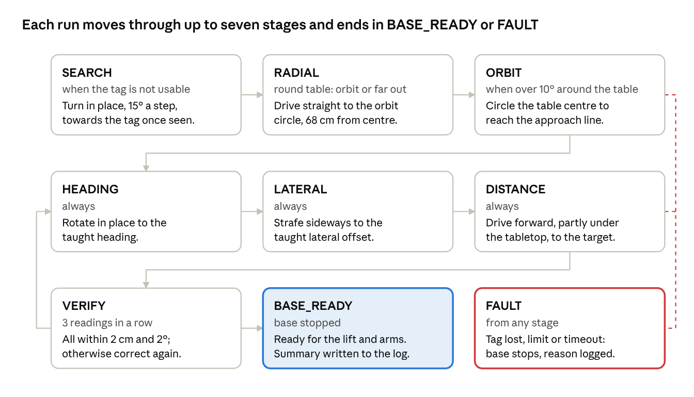
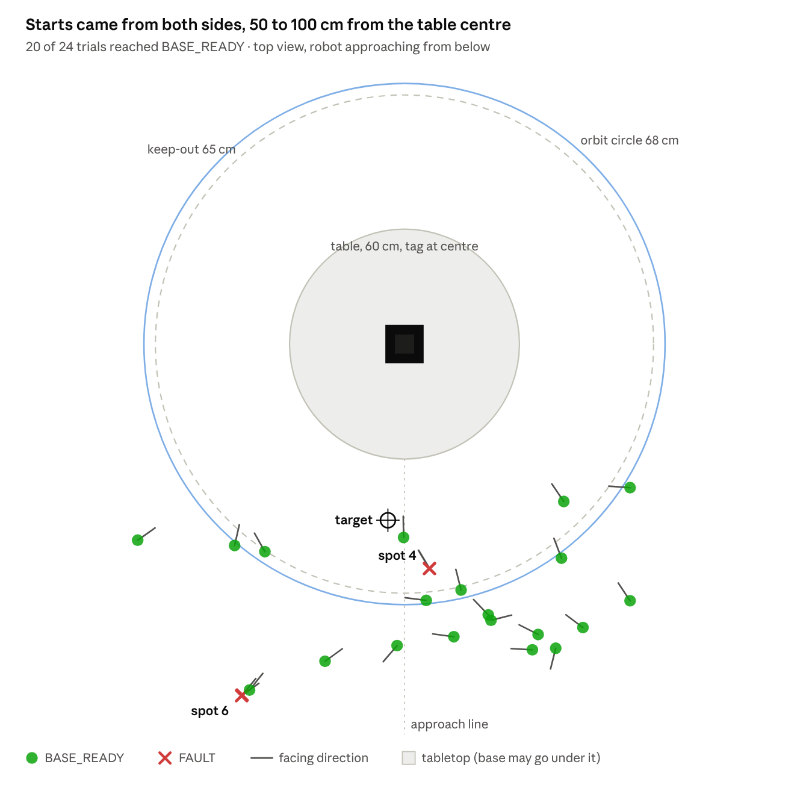
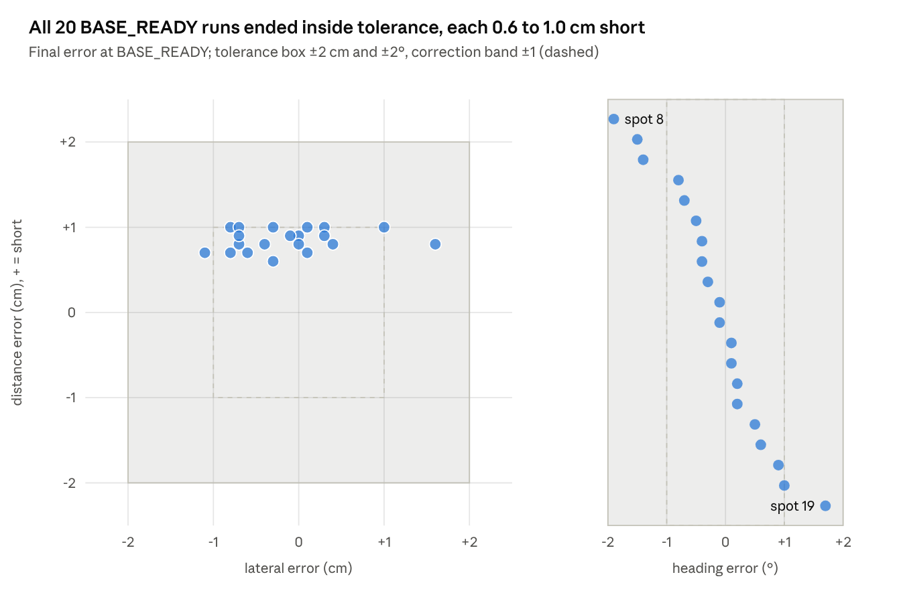

# AlohaMini2 Pro Table Alignment Project

2026-10-16 · Hao Chen

Project record. The living copy (editable, with interactive charts) is the Claude doc
[AlohaMini2 Pro Table Alignment Project](https://claude.ai/code/artifact/48d4d779-3556-45df-a9e9-604e33796a3f);
the original plan is [`aloha_mini2_pro_table_base_alignment.md`](../../aloha_mini2_pro_table_base_alignment.md).

## Summary

The AlohaMini2 Pro base now drives itself from a rough start to a taught pose at a round table, within 2 cm and 2°,
before any lift or arm work starts. In the first hardware robustness run on 2026-10-16, 20 of 24 trials reached
BASE_READY; every one of them finished inside tolerance, with a median time of 37 s.

- **Goal:** a safe, modular base-alignment step for the robot (three omniwheels), so a VLA policy always starts from
  the same pose at the table. Base only; lift and arms are a separate, later step.
- **What was built:** a verified-stop base controller, AprilTag table perception from the forward camera, a
  closed-loop alignment behaviour (search, move to an orbit circle, orbit, heading, lateral, distance, verify),
  safety limits, trial logging and a report tool.
- **Status:** all 8 milestones of the specification passed on hardware (2026-10-09). The system was then extended for
  a new camera, a round table and wider start poses. One fault type from the robustness run (a stalled radial move)
  is still open.
- **Where it lives:** branch `alohamini-base-safe-stop` on the fork `haochen1050/lerobot_alohamini`, 26 commits from
  2026-10-08 to 2026-10-16, about 7,600 lines including tests.

## Hardware and setup

The alignment uses one forward camera and one AprilTag; everything else is the robot's existing base.

| Item | Setup |
| --- | --- |
| Robot | AlohaMini2 Pro, three-omniwheel base, wheel radius 0.063 m, base radius 0.195 m |
| Wheels | Feetech STS3250, IDs 8 (left), 9 (back), 10 (right), velocity mode, on the left-arm bus `/dev/am_arm_follower_left` with a separate base power switch |
| Body frame | x forward, y left, rotation counter-clockwise from above (checked on hardware) |
| Computer | Raspberry Pi 5 on the robot runs the alignment; the host program must be stopped (it holds the serial port and cameras) |
| Forward camera | Intel RealSense D405, colour stream at 640x480, about 135 cm above the floor and 10 cm ahead of the base centre (was a 110 cm UVC camera until 2026-10-15) |
| Camera device | udev rule maps the D405 colour node (`ATTR{index}=="4"`) to `/dev/am_camera_forward` |
| Intrinsics | D405 factory calibration: fx 390.3, fy 389.3, cx 325.3, cy 242.8; its distortion projects like OpenCV within 0.03 px |
| Extrinsics | camera pose on the robot, from the tag lying at a measured spot on the table |
| Tag | AprilTag 36h11, 10 cm black square, flat at the centre of the table |
| Table | round, 60 cm across (radius 0.30 m), three legs; at the target the base is partly under the tabletop |
| Taught target | 16.0 cm from the rim, +4.3 cm lateral, +3.1°, recorded with `teach` at the desired pose |

The target is taught rather than computed, so small errors in the camera calibration cancel out.

## How it works

The robot works in short steps: measure the table pose from the camera, send one short pulse, stop, and measure
again.



The top row only runs when needed; the middle row always runs, and a VERIFY failure loops back to correct again.

- **Perception.** The forward camera finds the AprilTag, solves its pose, and turns it into the table's pose in the
  robot frame. From that it computes three errors against the taught target: distance (+ = drive forward), lateral
  (+ = strafe left) and heading (+ = rotate counter-clockwise).
- **Round-table geometry.** With `--table-radius`, the table centre is that radius into the table from the approach
  point. The radial move and the orbit both work around that centre, so the distance to the rim stays constant while
  orbiting.
- **Keeping the tag in view.** Before each pulse the robot predicts where the tag will appear in the image. If it
  would come within 30 px of the edge, it corrects another axis first, turns to keep looking at the tag, or shortens
  the pulse. During the pulse it watches the tag and stops early near the edge or after 3 missed frames. If the tag
  is lost anyway, it reverses the pulse and, if needed, turns up to ±20° to find it.

## Safety design

Every motion is a short pulse that ends in a stop read back from each wheel, and every limit stops the run instead
of driving on.

| Guard | What it does |
| --- | --- |
| Verified stop | zero is written to each wheel separately and read back, up to 3 attempts; a stop that cannot be confirmed says "cut base power" |
| Interrupts | Ctrl+C, SIGTERM and SSH hang-up are held until a stop finishes, then the base stops |
| Short pulses | 0.3 s for corrections, up to 1 s for search, radial and orbit moves; speed at most 5 cm/s and 15°/s |
| Fresh readings | the robot only acts on the median of 3 frames captured after it stopped and settled 0.4 s; stale or missing frames fault |
| Progress checks | an error that grows after a correction, or an orbit or radial step that does not get closer, stops the run (this is what a wrong sign or slipping wheels looks like) |
| Keep-out circle | while orbiting, the base centre stays at least 65 cm from the table centre (table radius + 0.25 m robot + 0.10 m), checked on the measured pose and along each planned pulse |
| Approach limit | the final approach never goes more than 3 cm past the taught distance |
| Travel budget | after the orbit: 60 cm and 60° net, 50 pulses, 120 s |
| Heading check | a tag reading more than 45° off is not trusted for alignment; it usually means the tag was turned |
| Keep the tag in view | each pulse is planned so the tag stays 30 px inside the image, watched while moving, and reversed if the tag is lost |

Software stopping is not an emergency stop: if the computer or the bus fails, the wheels keep their last speed. A
physical power cut-off within reach is still required, and a hardware watchdog is an open item.

## Code and tools

The work is a reusable module under `src/lerobot/robots/alohamini/`, thin command-line scripts in `examples/debug/`,
and tests that run without hardware.

| Part | Path | Role |
| --- | --- | --- |
| Kinematics | `base/omni_kinematics.py` | body velocity to wheel speeds and back, matching the robot driver |
| Base controller | `base/base_controller.py` | velocity pulses, verified stop, interrupt handling, wheel-bus check |
| Geometry | `perception/geometry.py` | transforms and averaging |
| Table pose | `perception/table_pose.py` | table frame, taught target, pose errors |
| Calibration | `perception/camera_calibration.py` | intrinsics (ChArUco), extrinsics, load and save |
| Tag estimator | `perception/apriltag_table_estimator.py` | tag detection, pose checks, bearing, edge margin, view prediction |
| Alignment | `behaviors/align_to_table.py` | the stage machine, safety limits, keep-in-view, start pose and summary |
| Wheel test | `examples/debug/wheels.py` | keyboard pulse teleop and stop test |
| Perception tool | `examples/debug/table_perception.py` | snapshot, calibration, RealSense intrinsics, watch, teach |
| Camera view | `examples/debug/camera_view.py` | live view with a tag check |
| Alignment run | `examples/debug/align_to_table.py` | runs one trial, writes a JSONL log |
| Report | `examples/debug/align_report.py` | one row per trial, success rate and error statistics, CSV |
| Tests | `tests/robots/test_alohamini_*.py` | 267 tests: kinematics, stops, rendered-tag perception, simulated alignment |
| Specification | `aloha_mini2_pro_table_base_alignment.md` | the original plan and its 8 milestones |

The upstream `main` branch was left untouched.

## How we did it

We followed the specification's milestones one at a time on hardware, then fixed each weakness the real robot
showed. Oldest first:

| Date | Step | What we found or changed |
| --- | --- | --- |
| 2026-10-08 | Milestone 1: safe stop | new base controller with per-wheel verified stop; found that the old `wheels.py` stop silently failed (a list passed where a name was expected); stop test passed once base power was on |
| 2026-10-08 | Milestone 2: directions | W/S/A/D/Q/E pulses confirmed x forward, y left, counter-clockwise rotation |
| 2026-10-08 | Milestone 3: perception | calibrated the camera with ChArUco and the tag; the tag on the floor was too far to detect, so extrinsics were done with the tag on the table |
| 2026-10-09 | Perception fixes | a bumped tag (turned 90° and 180°) produced bogus targets; added the ±45° heading check, tag-placement records and a mismatch refusal |
| 2026-10-09 | Milestones 4–7 | heading, lateral, distance and full alignment converged from messy poses and stayed still |
| 2026-10-09 | Milestone 8: faults | tag loss, Ctrl+C, SSH hang-up, camera unplug, timeout and base power off all stopped safely |
| 2026-10-09 | Vertical tag | option to hang the tag on the table edge |
| 2026-10-10 | Search | rotate in place to find the tag when the camera starts facing away |
| 2026-10-10 | Orbit | circle the approach point when the robot starts off to the side |
| 2026-10-15 | New camera | camera moved to 135 cm and replaced by a RealSense D405; added udev mapping and factory intrinsics |
| 2026-10-15 | Tag kept in view | the tag was often lost during pulses; added plan, watch and recover, plus a ±20° turn when reversing is not enough |
| 2026-10-15 | Square-up | a robot in front but turned more than 45° faulted after 0 pulses; search now turns towards a seen tag |
| 2026-10-15 | Round table | "too close" fault at 22 cm from a straight-edge model when the real rim was 46 cm away; orbit now circles the table centre |
| 2026-10-16 | Keep-out circle | orbit keeps the base centre at least 65 cm from the table centre |
| 2026-10-16 | Travel budget | a run stopped at 40 cm of commanded travel while still approaching; raised to 60 cm and 50 pulses |
| 2026-10-16 | Trial records | start pose, run summary, `--note` and the report tool |
| 2026-10-16 | Orbit circle | move to 68 cm from the table centre first, then orbit; final approach now uses at most 20 cm in simulation |
| 2026-10-16 | Robustness run | 24 hardware trials from 20 spots (results below) |

## Test results

All 8 specification milestones passed on hardware, 267 automated tests pass, and the first robustness run reached
BASE_READY in 20 of 24 trials.

### Milestones on hardware

Run on 2026-10-08 and 2026-10-09 with the earlier 110 cm camera and the tag 15 cm from the table edge.

| Milestone | Test | Result |
| --- | --- | --- |
| 1 Safe stop | pulse test, Ctrl+C mid-pulse | pass: wheels at zero within about 0.5 s |
| 2 Directions | W/S/A/D/Q/E pulses | pass: x forward, y left, counter-clockwise |
| 3 Perception | live readings at the target and moved by hand | pass: reads 0/0/0 at the target, noise under 0.1 mm and 0.02°, all signs correct |
| 4 Heading | from −16.4° and +23.1° | pass: to −1.0° and +0.6°, 6 pulses |
| 5 Lateral | from +13.8 cm and −14.2 cm | pass: to +0.5 cm and −0.7 cm, 10 pulses each |
| 6 Distance | from +14.7 cm and −9.7 cm | pass: to +0.7 cm (12 pulses) and −0.9 cm (7 pulses) |
| 7 Full alignment | several messy start poses | pass: every trial reached BASE_READY and stayed still |
| 8 Fault injection | tag loss, Ctrl+C, SSH hang-up, camera unplug, timeout, base power off | pass: every case stopped safely |

### Automated tests

- 267 tests pass on the PC without hardware: kinematics against the robot driver, verified stop with a fake bus,
  perception on rendered tag images, and the alignment in a simulated world.
- Keep-the-tag-in-view sweep: 480 simulated runs with noise, a narrow camera view and wheel efficiency 0.6–1.1; all
  reached BASE_READY with the tag never leaving the image.
- Round-table sweep: 156 simulated starts, −60° to +60° around the table and 0.55–1.1 m from its centre; all reached
  BASE_READY, using at most 0.20 m of travel and 25 pulses after the orbit.

### Hardware robustness run, 2026-10-16

24 trials from 20 start spots around the 60 cm round table, with the D405 camera at 135 cm and the tag at the table
centre. All rows: [`trials_2026-10-16.csv`](trials_2026-10-16.csv).





- **Time and effort:** median 37 s and 24 pulses to BASE_READY; the longest run took 59 s (spot 12, which first
  searched 255°).
- **Search and orbit:** 12 trials needed a search and 17 an orbit; no run needed a recovery or hit the travel or
  pulse limits.
- **Faults:** spot 4 faulted twice with "inside the orbit keep-out circle" on code from before the orbit-circle
  update, then succeeded from slightly further out. Spot 6 faulted twice when the radial move did not move the
  robot, then succeeded on the third try (see Open issues).

## Open issues and next steps

The stalled radial move is the one open fault; the rest are improvements or follow-on work.

- [ ] **Radial move stall (spot 6).** Confirm the cause from the log, then turn to face the table centre before the
  radial move, keep radial pulses at least about 0.5 s, and judge progress only on pulses that ran most of their
  length.
- [ ] **Repeatability.** Run a few spots 3–5 times each with the same `--note`, and add starts closer than 60 cm and
  further than 1 m.
- [ ] **Distance bias.** The robot stops 0.6–1.0 cm short every time; decide whether the arms need it tighter.
- [ ] **Hardware fail-safe.** The servo control table has no communication watchdog, so add an e-stop or watchdog
  relay before unattended use.
- [ ] **Start-heading estimate.** After a search, the start heading assumes no wheel slip while turning; treat it as
  approximate.
- [ ] **Next stage: lift and arms.** After BASE_READY, bring the lift and both arms to the ready posture for VLA
  deployment, with the base locked. The forward camera moved, so data recorded with the old camera must be
  re-recorded before training.

## How to run

Run on the Pi in the `lerobot_alohamini` conda env, from `~/lerobot_alohamini`, with the host program stopped and
base power on.

1. Get the code: `git pull fork alohamini-base-safe-stop`.
2. Check the wheels: `python examples/debug/wheels.py --port /dev/am_arm_follower_left --pulse-test`.
3. Camera intrinsics (D405): `python examples/debug/table_perception.py realsense-intrinsics`.
4. Extrinsics, with the tag flat on the table at a measured spot:
   `python examples/debug/table_perception.py calibrate-extrinsics --tag-x <fwd m> --tag-y <left m> --tag-z 0.74 --tag-yaw-deg <-90 or 0>`.
5. Put the tag at the table centre, park the robot at the desired pose and teach it:
   `python examples/debug/table_perception.py teach --tag-edge-offset 0.3 --tag-yaw-deg -90`.
6. Check live readings: `python examples/debug/table_perception.py watch --tag-edge-offset 0.3 --tag-yaw-deg -90`.
7. Align, one trial per start spot:

   ```
   python examples/debug/align_to_table.py --tag-edge-offset 0.3 --table-radius 0.3 \
       --axes heading,lateral,distance --search-direction cw --note "spot 1"
   ```

8. Report all trials: `python examples/debug/align_report.py --since 20261016 --csv outputs/table_alignment/report.csv`.

Re-teach whenever the tag or the camera moves. Useful options: `--dry-run`, `--orbit-radius`, `--keepout-radius`,
`--max-travel`, `--recover-scan-deg`, `--no-search`, `--no-orbit`, `--no-keep-view`. Logs are in
`outputs/table_alignment/logs/`.
